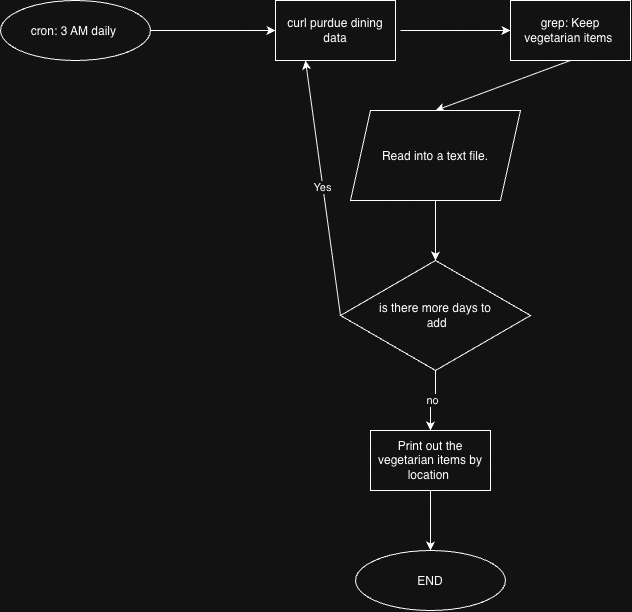

# Purdue Veg

A Bash script that collects vegetarian menu items from Purdue dining locations so you can see what's available before you go.

## The Problem

My friends and I are vegetarian, and we have noticed that some dining halls don't have many vegetarian options. What's annoying currently is that because the meals switch for each meal session, we have to check menus directly before seeing which dining hall has vegetarian food close to us. This is a big frustrating for me because some of the days, I find myself going to wrong dining halls as sometimes the vegetarian options aren't too good.

## How It Works

The MVP does the following:

- Fetches menu data for every location the Purdue dining API publishes: dining courts, On-the-GO!s, and Quick Bites
- Keeps only the vegetarian items
- Saves results in files organized by date and location
- Covers the next 10 days of menus
- Prints the vegetarian items grouped by location



The full prioritization is in the [Eisenhower Matrix](docs/eisenhower-matrix.pdf).

## Changes since ideation

- The dining API does not include ingredients, so the script cannot show what is in each item.
- 1bowl at Meredith Hall and Sushi Boss at South Hall are included with the other locations. The API still does not flag any of their items as vegetarian.
- jq was added. The menu JSON is nested, and grep or sed cannot reliably pull out meals, stations, and items.

## Tech Stack

- **Language:** Bash
- **External tools:** curl, grep, sed, awk, date, mkdir, find, cron, jq
- **Storage:** plain text files, one folder per day, one file per location
- **Data source:** Purdue Housing and Food Services dining menu API (`https://api.hfs.purdue.edu/menus/v2`), which returns JSON. It's undocumented and unofficial, so it could change.

The script runs on macOS and Linux. Date math uses GNU `date -d` when it is available, and macOS `date -v` otherwise.

## Setup

macOS already includes `curl` and `column`. `column` is what `list` uses to line up the location IDs. Install `jq`:

```bash
brew install jq
```

On Ubuntu or Debian:

```bash
sudo apt install curl jq bsdextrautils
```

Then clone the repo and run it:

```bash
git clone https://github.com/yashwanthtanguturi/purdue-veg.git
cd purdue-veg
chmod +x purdue-veg.sh
```

Fetch the menus, then print today:

```bash
./purdue-veg.sh update
./purdue-veg.sh day
```

To refresh every day at 3 AM, add this to your crontab (`crontab -e`). Cron only runs while the computer is awake.

```cron
0 3 * * * cd /path/to/purdue-veg && ./purdue-veg.sh update >> cron.log 2>&1
```

Replace `/path/to/purdue-veg` with the folder you cloned into.

## Usage

```text
./purdue-veg.sh update            Fetch the next 10 days of menus
./purdue-veg.sh list              List locations and their IDs
./purdue-veg.sh hours [DATE]      Show hours for every location
./purdue-veg.sh day [DATE]        Show vegetarian items at every location
./purdue-veg.sh show ID [DATE]    Show vegetarian items at one location
```

`DATE` is `YYYY-MM-DD` and defaults to today. Example:

```bash
./purdue-veg.sh hours 2026-11-30
./purdue-veg.sh show FORD 2026-11-30
```

## Limitations

The location list comes from `https://api.hfs.purdue.edu/menus/v2/locations`, so a new dining location is picked up the next time the script runs. `locations.txt` is only used when that request fails.

1bowl at Meredith Hall and Sushi Boss at South Hall are on that list, but Purdue does not flag any of their items as vegetarian, so no menu file is saved for them. Ask at the counter.

Cron only runs while the computer is awake, so scheduled updates are skipped if it's asleep. Run `./purdue-veg.sh update` manually to refresh.

## Roadmap

- [x] Show each location's hours
- [ ] Show ingredients for each item
- [ ] Filter by meal
- [ ] Favorites list that highlights favorite items
- [ ] Email when a favorite is being served
- [ ] Mark vegan items separately

## Author

Yashwanth Tanguturi ([GitHub](https://github.com/yashwanthtanguturi))
