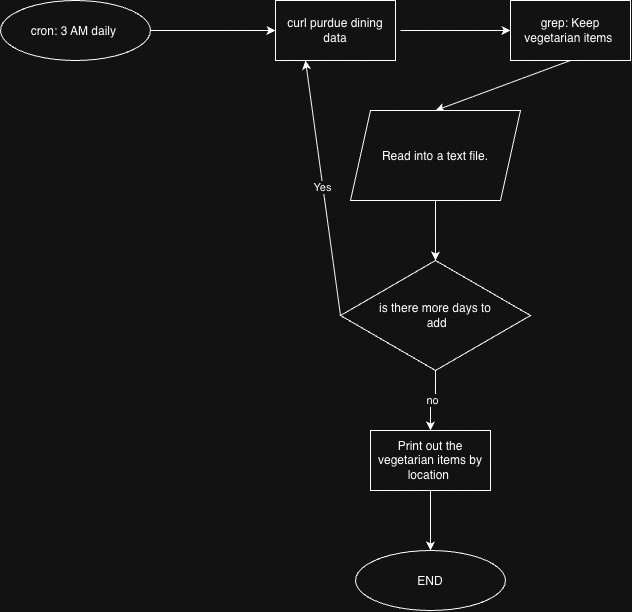

# Purdue Veg

A Bash script that collects vegetarian menu items from Purdue dining locations so you can see what's available before you go.

## The Problem

My friends and I are vegetarian, and we have noticed that some dining halls don't have many vegetarian options. What's annoying currently is that because the meals switch for each meal session, we have to check menus directly before seeing which dining hall has vegetarian food close to us. This is a big frustrating for me because some of the days, I find myself going to wrong dining halls as sometimes the vegetarian options aren't too good.

## How It Works

The MVP does the following:

- Fetches menu data for dining courts, On-the-GO!s, and Quick Bites
- Keeps only the vegetarian items
- Saves results in files organized by date and location
- Covers the next 10 days of menus
- Prints the vegetarian items grouped by location

The full prioritization is in the [Eisenhower Matrix](docs/eisenhower-matrix.pdf).

## Tech Stack

- **Language:** Bash
- **External tools:** curl, grep, sed, awk, date, mkdir, find, cron, jq
- **Storage:** plain text files, one folder per day, one file per location
- - **Data source:** Purdue Housing and Food Services dining menu API (`https://api.hfs.purdue.edu/menus/v2`), which returns JSON. It's undocumented and unofficial, so it could change.

## Setup
Coming soon. This will be filled once the script is tested. 

## Usage
Coming soon. This will be filled in with the real command and sample output once the script works.

## Roadmap

- [ ] Show each location's hours
- [ ] Show ingredients for each item
- [ ] Filter by meal
- [ ] Favorites list that highlights favorite items
- [ ] Email when a favorite is being served
- [ ] Mark vegan items separately

## Author

Yashwanth Tanguturi ([GitHub](https://github.com/yashwanthtanguturi))
